## Last time

::: {.subtitle-frame}
RStudio: four panes, a project, a script. The working directory. Reading an error.
:::

- You open **RStudio**, never R. The script is what you keep; the console is a scratchpad
- A **project** is the folder R opens in: `here("data", "file.csv")` works on your laptop and on the exam machines
- `Cmd/Ctrl + Enter` runs the line. Red text is R talking, not R breaking
- The one-line setup: `source("https://sbd-26-27.netlify.app/materials/setup.R")`

Today we use all of it, on every method Prof. Arbia has covered.

## Today

| Time | | Min |
|---|---|---|
| 16:00 | The map · how a lab works | 15' |
| 16:15 | Foundations: one mean, two means, three groups | 25' |
| 16:40 | Regression: simple, multiple, nonlinear · train and test | 35' |
| 17:15 | [**Break**]{.gold} | [10']{.gold} |
| 17:25 | GLM: logit, Poisson, survival | 30' |
| 17:55 | Ridge and LASSO | 15' |
| 18:10 | Time series: decompose, smooth, ARIMA | 25' |
| 18:35 | A CSV from the course site: download, read, answer | 25' |

: {tbl-colwidths="[14,76,10]"}

## The map

<div class="viz">
<svg viewBox="-140 0 1430 570" style="max-width:1120px;max-height:540px" xmlns="http://www.w3.org/2000/svg" font-family="Libre Franklin, sans-serif" fill="#1c2226">
  <!-- spokes -->
  <g stroke="#b8860b" stroke-width="3" fill="none">
    <line x1="600" y1="285" x2="300" y2="112"/>
    <line x1="600" y1="285" x2="900" y2="112"/>
    <line x1="600" y1="285" x2="1010" y2="300"/>
    <line x1="600" y1="285" x2="900" y2="470"/>
    <line x1="600" y1="285" x2="300" y2="470"/>
    <line x1="600" y1="285" x2="190" y2="300"/>
  </g>
  <!-- centre -->
  <circle cx="600" cy="285" r="92" fill="#002f57"/>
  <text x="600" y="276" text-anchor="middle" fill="#fff" font-size="28" font-weight="700">Module 1</text>
  <text x="600" y="306" text-anchor="middle" fill="#fff" font-size="19">one question,</text>
  <text x="600" y="330" text-anchor="middle" fill="#fff" font-size="19">one line of R</text>
  <!-- 1 foundations -->
  <g>
    <circle cx="300" cy="112" r="10" fill="#b8860b"/>
    <text x="280" y="60" text-anchor="end" fill="#002f57" font-size="24" font-weight="700">1 · Foundations</text>
    <text x="280" y="88" text-anchor="end" font-size="17" font-family="JetBrains Mono, monospace">t.test · aov · TukeyHSD</text>
    <text x="280" y="114" text-anchor="end" font-size="16" fill="#b8860b" font-weight="600">mtcars · PlantGrowth</text>
    <text x="280" y="140" text-anchor="end" font-size="16" fill="#5f6b75">is the mean 20? do two groups differ? three?</text>
  </g>
  <!-- 2 regression -->
  <g>
    <circle cx="900" cy="112" r="10" fill="#b8860b"/>
    <text x="920" y="60" fill="#002f57" font-size="24" font-weight="700">2 · Regression</text>
    <text x="920" y="88" font-size="17" font-family="JetBrains Mono, monospace">lm · poly · predict</text>
    <text x="920" y="114" font-size="16" fill="#b8860b" font-weight="600">mtcars · cars</text>
    <text x="920" y="140" font-size="16" fill="#5f6b75">how much per unit? train vs test</text>
  </g>
  <!-- 3 glm -->
  <g>
    <circle cx="1010" cy="300" r="10" fill="#b8860b"/>
    <text x="1030" y="270" fill="#002f57" font-size="24" font-weight="700">3 · GLM</text>
    <text x="1030" y="298" font-size="17" font-family="JetBrains Mono, monospace">glm · survfit · coxph</text>
    <text x="1030" y="324" font-size="16" fill="#b8860b" font-weight="600">mtcars · warpbreaks · lung</text>
    <text x="1030" y="350" font-size="16" fill="#5f6b75">yes/no · a count · a time</text>
  </g>
  <!-- 4 regularisation -->
  <g>
    <circle cx="900" cy="470" r="10" fill="#b8860b"/>
    <text x="920" y="470" fill="#002f57" font-size="24" font-weight="700">4 · Ridge, LASSO</text>
    <text x="920" y="498" font-size="17" font-family="JetBrains Mono, monospace">glmnet · cv.glmnet</text>
    <text x="920" y="524" font-size="16" fill="#b8860b" font-weight="600">mtcars, all 10 predictors</text>
    <text x="920" y="550" font-size="16" fill="#5f6b75">too many columns for 32 rows</text>
  </g>
  <!-- 5 time series -->
  <g>
    <circle cx="300" cy="470" r="10" fill="#b8860b"/>
    <text x="280" y="470" text-anchor="end" fill="#002f57" font-size="24" font-weight="700">5 · Time series</text>
    <text x="280" y="498" text-anchor="end" font-size="17" font-family="JetBrains Mono, monospace">decompose · HoltWinters · arima</text>
    <text x="280" y="524" text-anchor="end" font-size="16" fill="#b8860b" font-weight="600">AirPassengers</text>
    <text x="280" y="550" text-anchor="end" font-size="16" fill="#5f6b75">trend, season, next year</text>
  </g>
  <!-- 6 your data -->
  <g>
    <circle cx="190" cy="300" r="10" fill="#b8860b"/>
    <text x="170" y="270" text-anchor="end" fill="#002f57" font-size="24" font-weight="700">6 · A CSV from the site</text>
    <text x="170" y="298" text-anchor="end" font-size="17" font-family="JetBrains Mono, monospace">download.file · read_csv</text>
    <text x="170" y="324" text-anchor="end" font-size="16" fill="#b8860b" font-weight="600">churn.csv, 7 000 customers</text>
    <text x="170" y="350" text-anchor="end" font-size="16" fill="#5f6b75">the same six questions, on real rows</text>
  </g>
</svg>
</div>

## Objectives

- Run **every method of Module 1** once, on a dataset that ships with R — no download, no setup
- Learn the one habit that carries the exam: **question → one line → read the output → write the sentence**
- Get a dataset from the course site into R, and answer business questions on it
- Leave with a script that reruns, top to bottom, on Friday's lab machines

## How a lab works

| Step | What you do | Example |
|---|---|---|
| **1 · Question** | a business question, in words | *do manual cars use less fuel?* |
| **2 · Data** | one table, one row per unit | `mtcars`, 32 cars |
| **3 · Line** | the one function that answers it | `t.test(mpg ~ am, data = mtcars)` |
| **4 · Read** | find the three numbers that matter | estimate, interval, p-value |
| **5 · Sentence** | the answer, with its uncertainty | *yes: 7 mpg more, between 3 and 11* |

Steps 3 and 4 are mechanical. **Steps 1 and 5 are the exam.** Today we do all five, six times.

## Datasets that ship with R

`data()` lists every one; `?mtcars` is the codebook; `head(mtcars)` the first rows.

| Dataset | Rows | What | We use it for |
|---|---|---|---|
| `mtcars` | 32 cars | fuel use, weight, power, gearbox | tests, regression, logit, LASSO |
| `PlantGrowth` | 30 plants | yield under three treatments | ANOVA |
| `cars` | 50 cars | speed, stopping distance | a curve, cross-validation |
| `warpbreaks` | 54 looms | breaks per loom, wool, tension | Poisson |
| `lung` | 228 patients | survival time, status, age, sex | survival |
| `AirPassengers` | 144 months | airline passengers, 1949–60 | time series |

: {tbl-colwidths="[20,16,38,26]"}

The same on every machine on Earth, which is why textbooks and help pages use them.

## [Section 1]{.section-kicker} Foundations {.section-slide background-color="#002f57"}

## Two means, watched



[Two means, the gap, and its interval. The test asks one thing: does zero fit inside?]{.muted}

## Look before you test

```{.r}
summary(mtcars$mpg)              # five numbers and the mean
table(mtcars$am)                 # 0 = automatic, 1 = manual
boxplot(mpg ~ am, data = mtcars) # the picture of the test you are about to run
```
```{.text code-line-numbers="false"}
   Min. 1st Qu.  Median    Mean 3rd Qu.    Max.
   10.4    15.4    19.2    20.1    22.8    33.9

 0  1
19 13
```

A test confirms what a plot already shows. **If the boxplot surprises you, the test will too** — look first.

## One mean: is the average 20 mpg?

:::: {.columns}
::: {.column width="52%"}
```{.r}
t.test(mtcars$mpg, mu = 20)
```
```{.text code-line-numbers="false"}
t = 0.085, df = 31, p-value = 0.9
95 percent confidence interval:
  17.92  22.26
mean of x: 20.09
```
:::
::: {.column width="48%"}
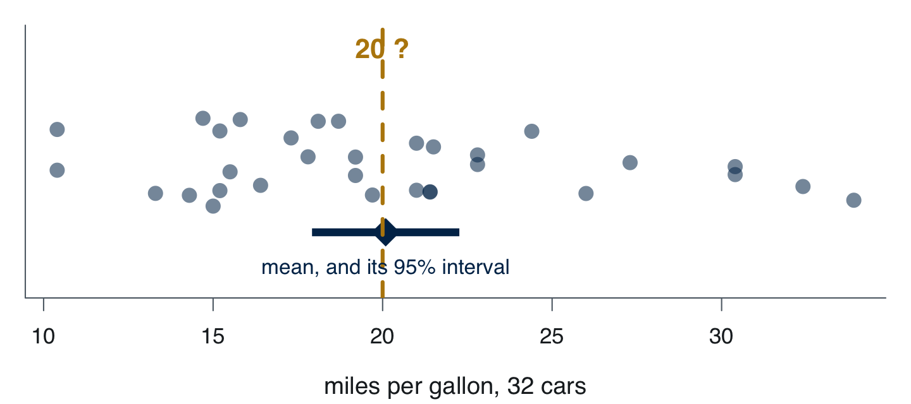{width=100%}
:::
::::

- **Estimate** 20.1 mpg · **interval** 17.9 to 22.3, *contains 20* · **p-value** 0.93: no evidence against 20

The sentence: *"Average consumption is compatible with 20 mpg; with 32 cars we cannot tell 20 from anything between 18 and 22."*

## Two means: do manual cars use less fuel?

:::: {.columns}
::: {.column width="56%"}
```{.r}
t.test(mpg ~ am, data = mtcars)   # Welch
```
```{.text code-line-numbers="false"}
t = -3.8, df = 18, p-value = 0.001
95 percent confidence interval:
  -11.28  -3.21
mean in group 0   mean in group 1
          17.15             24.39
```
:::
::: {.column width="44%"}
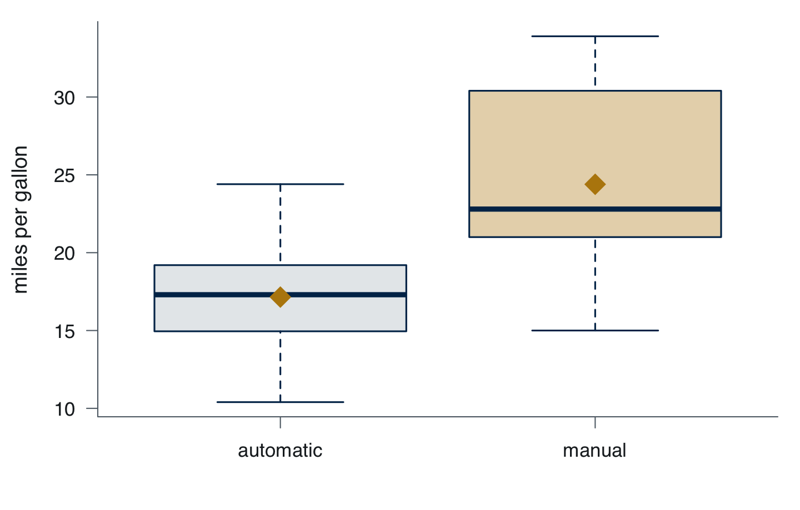{width=100%}
:::
::::

Manual cars do **7.2 mpg more**, and the interval says between **3.2 and 11.3**: it does not contain zero.

::: {.callout-note}
The interval is the answer; the p-value only says the interval misses zero. *"p = 0.001"* tells the board nothing. *"Seven more miles per gallon, at least three"* does.
:::

## Three groups: ANOVA

:::: {.columns}
::: {.column width="56%"}
```{.r}
fit <- aov(weight ~ group, data = PlantGrowth)
summary(fit)
TukeyHSD(fit)        # which pairs differ
```
```{.text code-line-numbers="false"}
         Df Sum Sq Mean Sq F value Pr(>F)
group     2   3.77   1.883    4.85  0.016

            diff    lwr    upr  p adj
trt1-ctrl -0.371 -1.062  0.320  0.391
trt2-ctrl  0.494 -0.197  1.185  0.198
trt2-trt1  0.865  0.174  1.556  0.012
```
:::
::: {.column width="44%"}
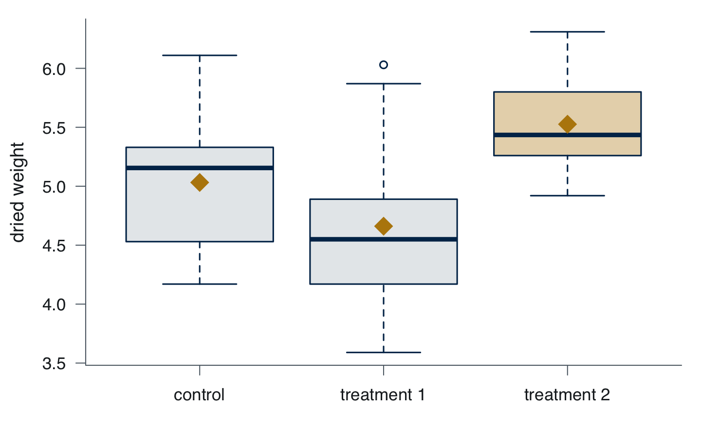{width=100%}
:::
::::

ANOVA says *some* group differs (p = 0.016). Tukey says *which*: only **treatment 2 vs treatment 1**. Neither treatment is distinguishable from the control. One line, then the honest sentence.

## Reading any test output

| Number | Where | What it answers |
|---|---|---|
| **Estimate** | `mean of x`, `diff`, `Estimate` | *how big?* |
| **Interval** | `95 percent confidence interval`, `lwr upr` | *how sure? — the range of plausible sizes* |
| **p-value** | `p-value`, `Pr(>F)` | *could this be noise?* |
| **n**, **df** | `df =` | *how much data is behind it* |

Read them in that order. A result with a tiny p-value and a tiny estimate is **significant and useless** — common with 7 000 rows, as we will see at the end.

## Exercises 1 · Foundations

Same datasets, your script, one line and one sentence each. Ten minutes.

1. Is the average horsepower in `mtcars` **150**? State the interval, not just the verdict
2. Do V-shaped engines (`vs = 0`) and straight ones (`vs = 1`) differ in `mpg`? By how much, *at least*?
3. Does `mpg` differ by number of cylinders? `factor(cyl)` turns 4, 6, 8 into groups. **Which pairs** differ?

[Solutions in the appendix at the end of the deck. Try before you look.]{.muted}

## [Section 2]{.section-kicker} Regression {.section-slide background-color="#002f57"}

## Least squares, watched



[`lm()` returns the line where the sum of the squares is smallest, and nothing else.]{.muted}

## Simple: what does weight cost in fuel?

:::: {.columns}
::: {.column width="56%"}
```{.r}
fit <- lm(mpg ~ wt, data = mtcars)
summary(fit)
plot(mpg ~ wt, data = mtcars); abline(fit)
```
```{.text code-line-numbers="false"}
            Estimate Std. Error t value
(Intercept)   37.285      1.878   19.86
wt            -5.344      0.559   -9.56

Multiple R-squared: 0.753  Adjusted: 0.745
```
:::
::: {.column width="44%"}
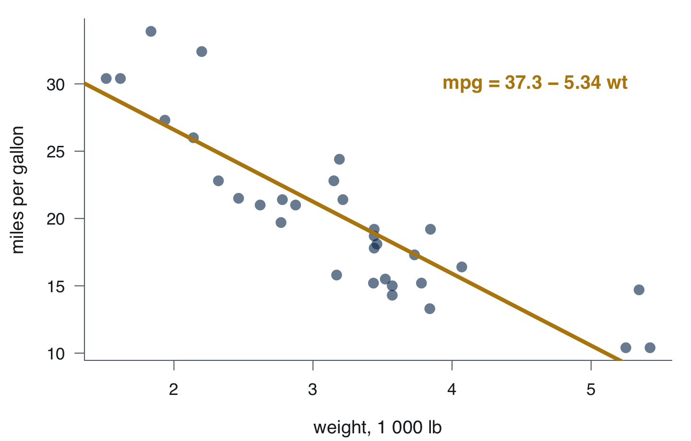{width=100%}
:::
::::

**Each extra 1 000 lb costs 5.3 mpg**, give or take 0.6. Weight alone explains **75%** of the variation in consumption. The intercept, 37 mpg for a weightless car, is a number nobody should quote.

## Multiple: weight *and* power

```{.r}
fit2 <- lm(mpg ~ wt + hp, data = mtcars)
summary(fit2)
```
```{.text code-line-numbers="false"}
            Estimate Std. Error t value  Pr(>|t|)
(Intercept) 37.22727    1.59879   23.28   < 2e-16
wt          -3.87783    0.63273   -6.13   1.1e-06
hp          -0.03177    0.00903   -3.52    0.0015

Multiple R-squared:  0.827,   Adjusted R-squared:  0.815
```

| | `mpg ~ wt` | `mpg ~ wt + hp` |
|---|---|---|
| weight | −5.3 | **−3.9** |
| power | — | −0.032 per hp: 100 hp ≈ 3 mpg |
| adjusted R² | 0.745 | **0.815** |

The weight effect shrinks by a quarter once power is in: alone, it was carrying power's effect too. *"Holding power fixed"* is the phrase that makes a multiple-regression coefficient mean something.

## Predict, with an interval

```{.r}
predict(fit2, newdata = data.frame(wt = 3, hp = 150), interval = "prediction")
```
```{.text code-line-numbers="false"}
    fit   lwr   upr
1 20.83 15.43 26.22
```

A 3 000 lb, 150 hp car: **about 21 mpg, and a new car of that kind could land anywhere between 15 and 26**.

- `interval = "confidence"` is the uncertainty on the *average* car of that kind — narrower
- `interval = "prediction"` is the uncertainty on *one* car — the one a buyer cares about

## Nonlinear: a curve where a line is wrong

:::: {.columns}
::: {.column width="56%"}
```{.r}
lm(dist ~ speed, data = cars)           # line
lm(dist ~ poly(speed, 2), data = cars)  # parabola
lm(dist ~ poly(speed, 9), data = cars)  # degree 9
```

| Degree | 1 | 2 | 9 |
|---|---|---|---|
| R² on the 50 cars | 0.651 | 0.667 | **0.713** |
:::
::: {.column width="44%"}
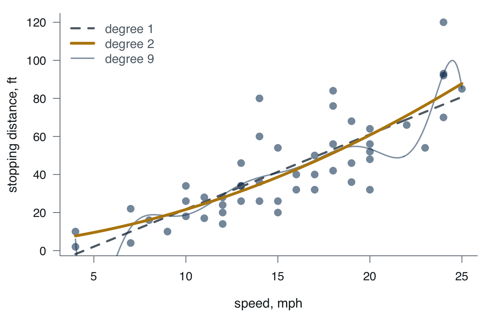{width=100%}
:::
::::

R² **always** rises with degree — a degree-49 polynomial would score 1.000 by passing through every point. So R² cannot choose the degree. Something that has never seen the data must.

## Bias–variance, in five lines

```{.r}
set.seed(1)
folds <- sample(rep(1:5, length.out = nrow(cars)))      # each car gets a fold 1–5
cv_mse <- function(d) mean(sapply(1:5, function(k) {
  fit <- lm(dist ~ poly(speed, d), data = cars[folds != k, ])   # fit on 4 folds
  mean((cars$dist[folds == k] - predict(fit, cars[folds == k, ]))^2)  # test on 1
}))
sapply(c(1, 2, 3, 5, 9), cv_mse)
```

:::: {.columns}
::: {.column width="60%"}
| Degree | 1 | **2** | 3 | 5 | 9 |
|---|---|---|---|---|---|
| CV error (MSE) | 239 | **227** | 319 | 322 | 9 410 |

Degree 9 fit the 50 cars best and predicts new cars **forty times worse**. That is variance. Degree 1 is a touch too stiff — that is bias. The **parabola** wins.
:::
::: {.column width="40%"}
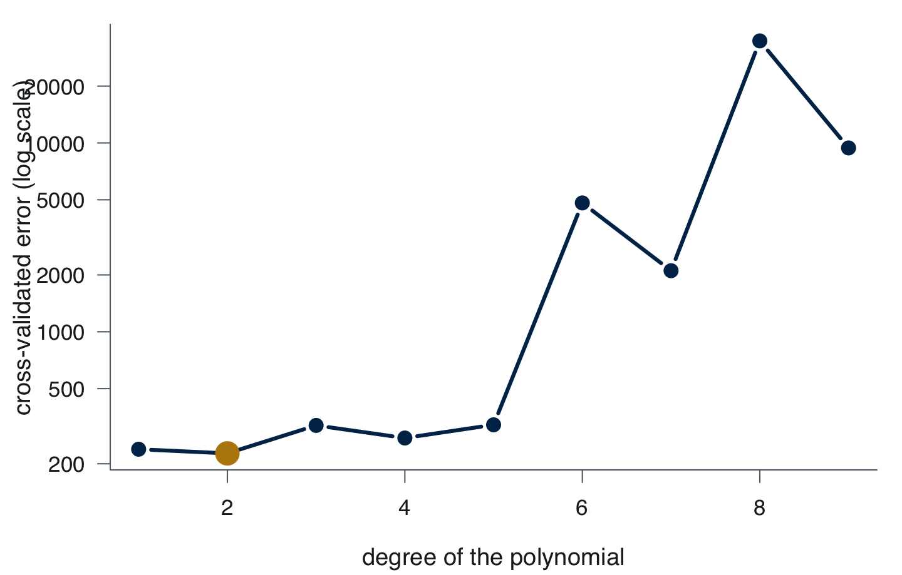{width=100%}
:::
::::

[And it is the one physics would have guessed: stopping distance grows with speed squared.]{.muted}

## Train and test, the habit

```{.r}
set.seed(1)                                   # same split for everyone
idx   <- sample(nrow(mtcars), 0.7 * nrow(mtcars))
train <- mtcars[idx, ]                        # the model learns here
test  <- mtcars[-idx, ]                       # locked until the end
fit   <- lm(mpg ~ wt + hp, data = train)
mean((test$mpg - predict(fit, test))^2)       # one number: error on cars never seen
```

::: {.callout-important title="Attention"}
A model is judged on rows it **did not see**. R², residual plots, p-values are all computed on the training rows, and all of them improve as the model gets more complicated. Only the test error can get worse — which is why it is the one you trust.
:::

## Exercises 2 · Regression

1. `mpg ~ hp`: how many mpg does a car lose **per 10 hp**? What share of the variation does power explain?
2. Add `qsec` (quarter-mile time) to `mpg ~ wt + hp`. Does it earn its place? Use its p-value *and* the adjusted R²
3. A 2 500 lb, 100 hp car: predicted mpg, and the range **a single car** could land in
4. Split `cars` 70/30 with `set.seed(1)`. Fit degrees 1, 2 and 3 on `train` and score each on `test`. Is the gap between degrees 1 and 2 large or small, compared with the jump to degree 3?

[Solutions in the appendix.]{.muted}

## [Section 3]{.section-kicker} GLM: a yes/no, a count, a time {.section-slide background-color="#002f57"}

## Logistic, watched



[A line through 0s and 1s leaves the unit interval; the logistic bend keeps it inside.]{.muted}

## Logistic: is this car a manual?

:::: {.columns}
::: {.column width="56%"}
```{.r}
fit <- glm(am ~ wt, data = mtcars,
           family = binomial)
exp(coef(fit))            # odds ratios
predict(fit, data.frame(wt = c(2.5, 3.5)),
        type = "response")  # probabilities
```
```{.text code-line-numbers="false"}
(Intercept)          wt
 169459.571       0.018   ← per 1 000 lb

    1     2
0.879 0.115
```
:::
::: {.column width="44%"}
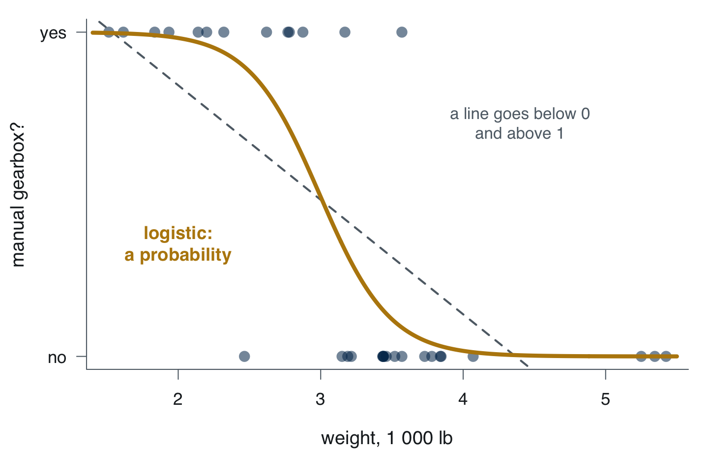{width=100%}
:::
::::

- Each extra 1 000 lb **multiplies the odds of a manual gearbox by 0.018**: heavy cars are automatic
- A 2 500 lb car: **88%** manual. A 3 500 lb car: **11%**. `type = "response"` gives a probability; without it you get log-odds, which nobody can read

## Poisson: how many breaks per loom?

:::: {.columns}
::: {.column width="56%"}
```{.r}
fit <- glm(breaks ~ wool + tension,
           data = warpbreaks,
           family = poisson)
exp(coef(fit))   # multiplicative effects
```
```{.text code-line-numbers="false"}
(Intercept)    woolB  tensionM  tensionH
     40.124    0.814     0.725     0.595
```
:::
::: {.column width="44%"}
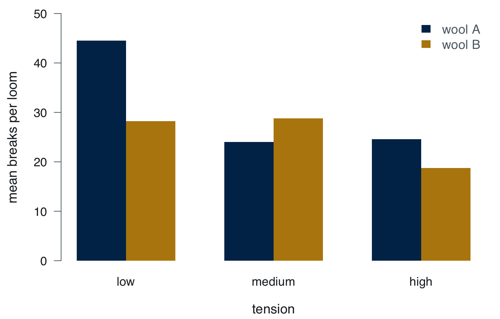{width=100%}
:::
::::

- Baseline, wool A at low tension: **40 breaks**. Wool B: **19% fewer** (×0.81). High tension: **40% fewer** (×0.60)
- For production: *wool B at high tension, expect about half the breaks*. `family = poisson` keeps a count positive and whole

## Survival: how long until the event?

:::: {.columns}
::: {.column width="58%"}
```{.r}
library(survival)
s  <- Surv(time, status)        # time + status
km <- survfit(s ~ sex, data = lung)
km; plot(km)                    # Kaplan–Meier
survdiff(s ~ sex, data = lung)  # log-rank
coxph(s ~ sex + age, data = lung)
```
```{.text code-line-numbers="false"}
        n events median 0.95LCL 0.95UCL
sex=1 138    112    270     212     310
sex=2  90     53    426     348     550
log-rank:  Chisq = 10.3 on 1 df, p = 0.001
Cox:       sex  coef -0.513  exp(coef) 0.599
```
:::
::: {.column width="42%"}
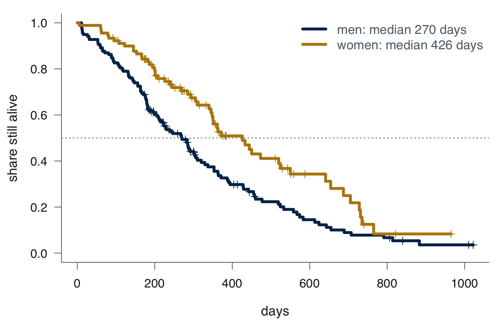{width=100%}
:::
::::

Median survival **270 days for men, 426 for women**; the hazard for women is **0.60** that of men, adjusting for age. `status` is what makes this survival and not regression: the people still alive are **censored**, not missing.

## Exercises 3 · GLM

1. Logistic `am ~ hp`. The odds ratio **per 10 hp** is `exp(10 * coef(fit)["hp"])`. P(manual) at 100 hp and at 200 hp?
2. Poisson on `InsectSprays` (72 plots, six sprays, `count ~ spray`). Which spray leaves the **fewest** insects, and by what factor compared with spray A?
3. Add `ph.ecog` (a 0–3 performance score) to the Cox model `~ sex + age`. Hazard ratio **per point**? Is `age` still in the picture?

[Solutions in the appendix.]{.muted}

## [Section 4]{.section-kicker} Ridge and LASSO {.section-slide background-color="#002f57"}

## Shrinkage, watched



[The penalty grows; seven coefficients reach exactly zero. Three columns survive.]{.muted}

## Ten predictors, thirty-two cars

```{.r}
summary(lm(mpg ~ ., data = mtcars))        # every column as a predictor
```

- Adjusted R² = 0.81, and **not one predictor is significant** (the smallest p-value is 0.06)
- Ten predictors on 32 rows: every coefficient is estimated on three cars' worth of information, and they all describe the same thing — a big engine
- Five-fold CV error of the full model: **20.9**. The two-predictor model from Section 2 did better

That is the high-dimensional problem in miniature. Ordinary least squares has no way to say *"too many columns"*.

## LASSO: let the data drop columns

:::: {.columns}
::: {.column width="58%"}
```{.r}
library(glmnet)
x <- model.matrix(mpg ~ ., mtcars)[, -1]
y <- mtcars$mpg
set.seed(1)
cv <- cv.glmnet(x, y, alpha = 1)  # 0 = ridge
coef(cv, s = "lambda.1se")
```

| | OLS | LASSO |
|---|---|---|
| `cyl` | −0.11 | **−0.84** |
| `hp` | −0.02 | **−0.007** |
| `wt` | −3.72 | **−2.37** |
| the other 7 | all nonzero | **all exactly 0** |
| CV error | 20.9 | **9.8** |
:::
::: {.column width="42%"}
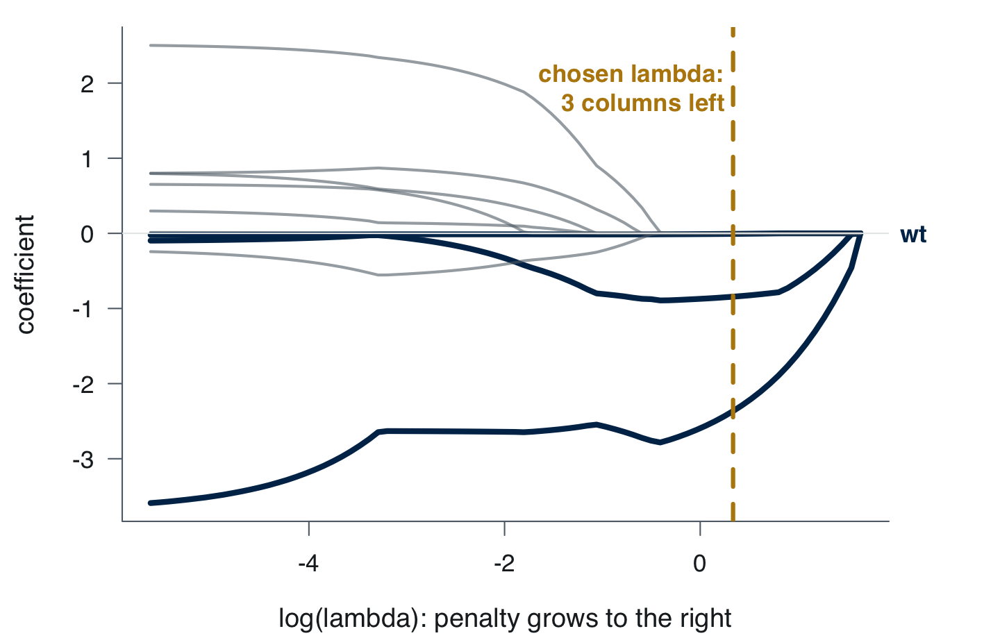{width=100%}
:::
::::

Three columns kept, **prediction error halved**. Ridge (`alpha = 0`) keeps all ten, shrunk: CV error 9.3. LASSO also tells you *which* three.

## Exercises 4 · Ridge and LASSO

1. Ridge on the same `x` and `y` (`alpha = 0`). How many coefficients are **exactly zero** at `lambda.1se`? CV error against LASSO's 9.8?
2. LASSO on `swiss` — 47 provinces of Switzerland in 1888, `Fertility ~ .`, five predictors. Which predictors **survive** at `lambda.1se`? Compare with the five that `lm` keeps

[Solutions in the appendix.]{.muted}

## [Section 5]{.section-kicker} Time series {.section-slide background-color="#002f57"}

## Decomposition, watched



[Trend from a moving average, season from twelve factors, the rest is remainder.]{.muted}

## A series is a vector that knows its dates

:::: {.columns}
::: {.column width="66%"}
```{.r}
AirPassengers             # 1949 – 1960
frequency(AirPassengers)  # 12: monthly
plot(AirPassengers)
```
```{.text code-line-numbers="false"}
     Jan Feb Mar Apr May Jun   Jul Aug Sep Oct Nov Dec
1949 112 118 132 129 121 135   148 148 136 119 104 118
1960 417 391 419 461 472 535   622 606 508 461 390 432
```
:::
::: {.column width="34%"}
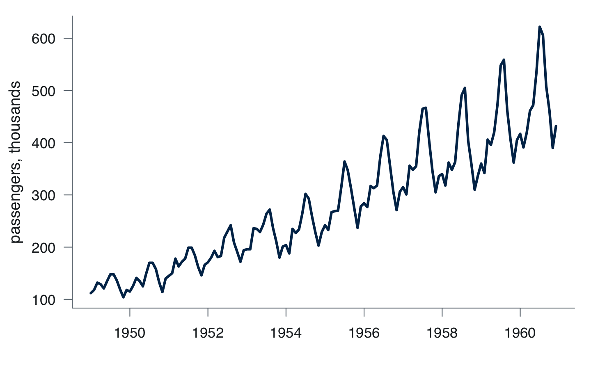{width=100%}
:::
::::

Two things visible without a model: **a trend** (four times more passengers in twelve years) and **a season** (July the peak, November the trough) whose swing **grows with the level** — the pattern that asks for a multiplicative model, or a log.

## Decompose: trend, season, remainder

:::: {.columns}
::: {.column width="62%"}
```{.r}
d <- decompose(AirPassengers,
               type = "multiplicative")
plot(d)
round(d$figure, 2)   # the 12 seasonal factors
```
```{.text code-line-numbers="false"}
 Jan  Feb  Mar  Apr  May  Jun
0.91 0.88 1.01 0.98 0.98 1.11
 Jul  Aug  Sep  Oct  Nov  Dec
1.23 1.22 1.06 0.92 0.80 0.90
```

**July runs 23% above the trend, November 20% below.** That is the sentence a planner needs: how much capacity to add in summer, as a share.
:::
::: {.column width="38%"}
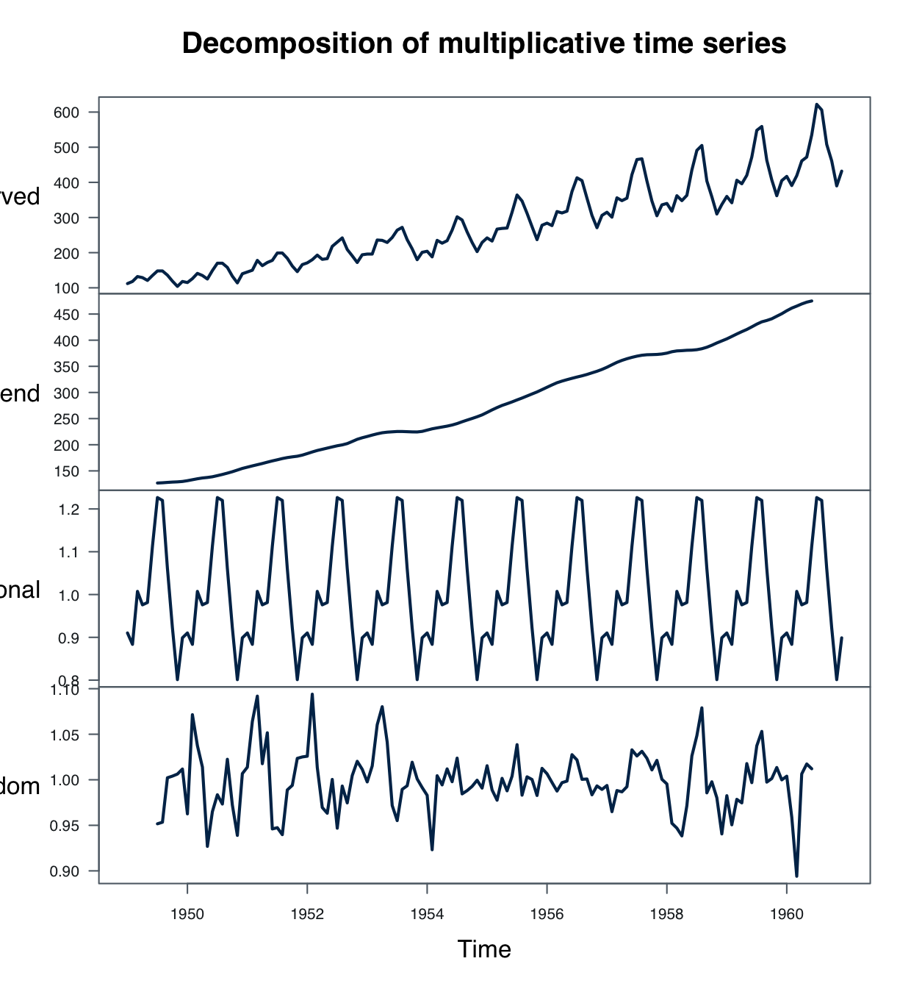{width=100%}
:::
::::

## Smoothing: Holt–Winters

:::: {.columns}
::: {.column width="60%"}
```{.r}
hw <- HoltWinters(AirPassengers,
                  seasonal = "multiplicative")
predict(hw, 12)     # the next twelve months
```
```{.text code-line-numbers="false"}
     Jan Feb Mar Apr May Jun
1961 447 420 465 496 508 575
     Jul Aug Sep Oct Nov Dec
     667 658 550 493 420 466
```
:::
::: {.column width="40%"}
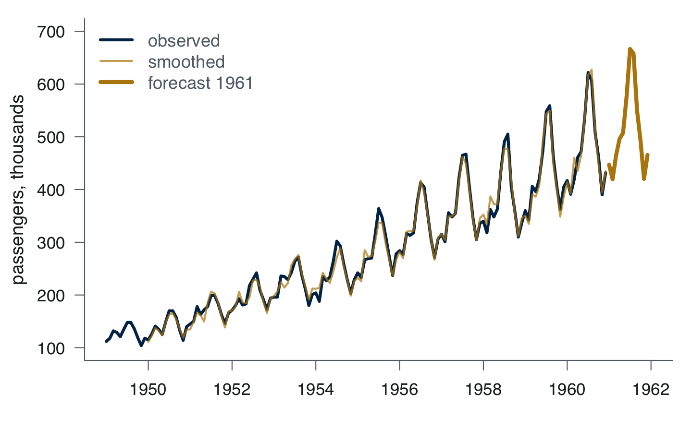{width=100%}
:::
::::

Three smoothing weights, estimated from the data: level 0.28, trend 0.03, season 0.87. No equation to defend, one forecast per month, and it already carries the season. **Fine for next year; silent about how wrong it might be.**

## ARIMA: the airline model

:::: {.columns}
::: {.column width="62%"}
```{.r}
fit <- arima(log(AirPassengers),
             order = c(0, 1, 1),
             seasonal = c(0, 1, 1))
exp(predict(fit, 12)$pred)   # back from the log
Box.test(residuals(fit), lag = 24,
         type = "Ljung-Box")
```
```{.text code-line-numbers="false"}
     Jan Feb Mar Apr May Jun
1961 450 426 479 492 509 583
     Jul Aug Sep Oct Nov Dec
     670 667 558 497 430 477
Box-Ljung: p = 0.3, nothing left in the residuals
```
:::
::: {.column width="38%"}
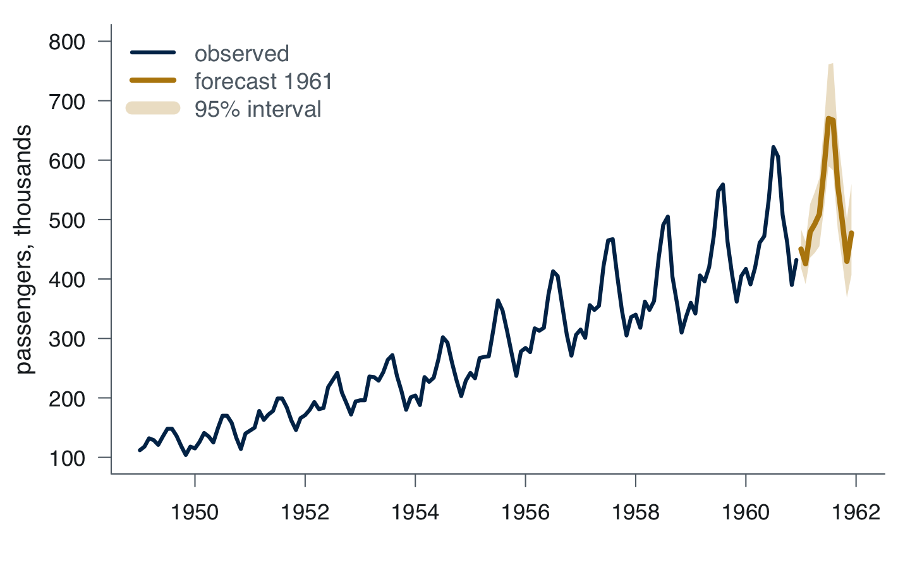{width=100%}
:::
::::

`log` makes the growing swing constant; the two `1`s difference away trend and season; the MA terms model what is left.

## ARIMA, read

- `forecast::auto.arima(AirPassengers, lambda = 0)` picks **exactly this model** on its own — the "airline model", named after this very series
- Holt–Winters and ARIMA agree **within 2%** on the point forecast
- Where they differ is the **interval**: ±8% in January, ±17% by December, and it widens honestly. Holt–Winters gave you no interval at all
- Ljung–Box p = 0.3: the residuals are noise. If they were not, the model would have left something on the table

## Exercises 5 · Time series

`co2`: monthly CO₂ at Mauna Loa, 1959–1997, 468 months. Already a `ts`.

1. `decompose(co2)`: **additive or multiplicative**, and why? Which month peaks, which troughs, by how many ppm?
2. `HoltWinters(co2)`, then twelve months ahead. What does **May 1998** look like?
3. `arima(co2, order = c(0, 1, 1), seasonal = c(0, 1, 1))` — no `log` this time: why? Compare its May 1998 with Holt–Winters', and check the residuals with `Box.test`

[Solutions in the appendix.]{.muted}

## [Section 6]{.section-kicker} A CSV from the course site {.section-slide background-color="#002f57"}

## Download, then read

```{.r code-line-numbers="1-2|4-6|8-9"}
library(tidyverse)
library(here)

dir.create(here("data"), showWarnings = FALSE)           # the project's data folder
download.file("https://sbd-26-27.netlify.app/materials/churn.csv",
              here("data", "churn.csv"))

churn <- read_csv(here("data", "churn.csv"))               # file → data frame
glimpse(churn)                                   # 7 000 rows, 20 columns, types
```

- `download.file` fetches once and keeps a copy in `data/`: the script works **offline, and on Friday's machines**
- `read_csv` guesses each column's type; `glimpse` shows the guess. **Check it before anything else**
- The same two lines read any CSV on the site: `customers.csv`, `brands.csv`

## The same questions, on 7 000 customers

:::: {.columns}
::: {.column width="58%"}
```{.r}
mean(churn$churn == "yes")       # 0.285
t.test(monthly_charge ~ churn, data = churn)
tab <- table(churn$contract, churn$churn)
prop.table(tab, 1)               # rates by row
```
```{.text code-line-numbers="false"}
mean no 63.54   mean yes 70.04   CI  -7.8  -5.2

                   no    yes
  month-to-month 0.592  0.408
  one-year       0.818  0.182
  two-year       0.919  0.081
```
:::
::: {.column width="42%"}
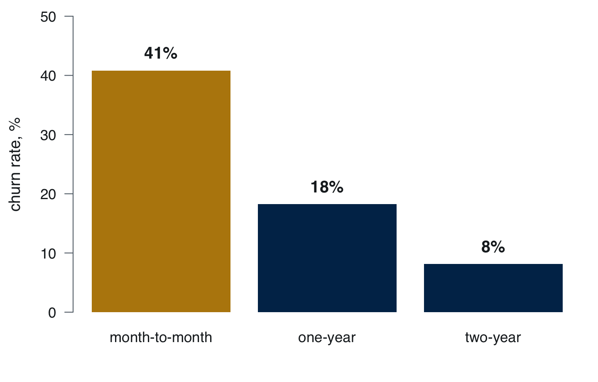{width=100%}
:::
::::

Leavers pay **€6.5 more a month** (between 5 and 8). Churn runs **41% on monthly contracts, 8% on two-year ones**. Two lines, two sentences a retention team can act on.

## Logistic, on the real thing

```{.r}
churn$churn <- factor(churn$churn)                          # "yes" is the event
fit <- glm(churn ~ tenure_months + contract + monthly_charge,
           family = binomial, data = churn)
exp(coef(fit))
predict(fit, newdata = data.frame(tenure_months = 3, contract = "month-to-month",
                                  monthly_charge = 90), type = "response")
```
```{.text code-line-numbers="false"}
  tenure_months contractone-year contracttwo-year  monthly_charge
          0.990            0.313            0.121           1.011
                                                          → 0.535
```

A two-year contract cuts the odds of leaving by **88%**. A new, month-to-month, €90 customer has a **53.5%** chance of churning: that is the customer the retention budget goes to.

## Significant, and useless

```{.r}
summary(aov(monthly_charge ~ contract, data = churn))       # p = 0.84
summary(lm(monthly_charge ~ data_gb + phone_lines + streaming_tv, data = churn))
```
```{.text code-line-numbers="false"}
Multiple R-squared:  0.000369,   Adjusted R-squared:  -5.9e-05
F-statistic: 0.862 on 3 and 6996 DF,  p-value: 0.46
```

::: {.callout-important title="Attention"}
With 7 000 rows almost anything becomes "significant", so a p-value stops being informative. Read the **size** — an R² of 0.0004 explains nothing — and the **interval**. And when the output honestly says *no*, as both of these do, the sentence is *"contract type does not change what people pay"*. An honest *no* is a result.
:::

## Your turn: fifteen minutes

On `churn.csv`, in your script, one line and one sentence each:

1. Do customers who leave have shorter **tenure**? (`t.test`) By how much?
2. Does churn rise with **support calls**? Make the table of churn rate by `support_calls`
3. Fit the logit above **plus `support_calls`**. What is its odds ratio? Is it the biggest effect in the model?
4. Split 70/30 with `set.seed(1)`. Fit on `train`, predict probabilities on `test`, and compute the share of churners among the **10% with the highest** predicted probability

Bring question 4's number on Friday. It is the number Module 2 starts from. [Solutions in the appendix.]{.muted}

## Every method in Module 1 is one line. The sentence after it is the exam. {.statement}

[Question · data · line · read · sentence]{.muted}

## Before Friday

**Friday 23 October, 10:00–13:00, Aula 1**: mock exam, on the lab machines.

- Rerun today's script on your laptop, top to bottom, from a fresh RStudio. If it stops, that line is your homework
- Put `churn.csv` in your project's `data/` folder with `download.file`, not by hand
- Open `?t.test`, `?lm`, `?glm` once. On Friday the help page is the only documentation you have

[The script is on the course site next to these slides. Retyping it is the better choice.]{.muted}

## Reading

- **ISLR** chapter 3 (regression), §4.3 (logistic), §6.2 (ridge and LASSO) — the methods of today, with the R labs at the end of each chapter
- **Provost & Fawcett** chapter 4, *Fitting a model to data*, and chapter 5, *Overfitting*: the bias–variance story told for managers
- **Shmueli & Polak** chapters 2–3: time series components and smoothing, in R
- Reference: `?t.test`, `?lm`, `?glm`, `?survfit`, `?cv.glmnet`, `?arima`

## [Appendix]{.section-kicker} Solutions {.section-slide background-color="#002f57"}

## Solutions 1 · Foundations

```{.r}
t.test(mtcars$hp, mu = 150)        # 146.7, interval 122 to 171, p = 0.79
t.test(mpg ~ vs, data = mtcars)    # 16.6 vs 24.6, gap between 4.4 and 11.5
TukeyHSD(aov(mpg ~ factor(cyl), data = mtcars))
```
```{.text code-line-numbers="false"}
       diff     lwr     upr  p adj
6-4  -6.921 -10.769 -3.072 0.0003
8-4 -11.564 -14.771 -8.357 0.0000
8-6  -4.643  -8.328 -0.958 0.0112
```

1. **Compatible with 150**: the interval runs from 122 to 171 hp; 32 cars cannot pin the mean down closer than that
2. Straight engines do **7.9 mpg more**, and at least **4.4**: the interval is well clear of zero
3. **Every pair differs**: 4 cylinders do 26.7 mpg, 6 do 19.7, 8 do 15.1. Even 8 vs 6, the closest pair, is at least 1 mpg apart

## Solutions 2 · Regression

```{.r}
lm(mpg ~ hp, data = mtcars)                  # hp −0.068, R² 0.60
lm(mpg ~ wt + hp + qsec, data = mtcars)      # qsec p = 0.25, adj R² 0.817
predict(fit2, data.frame(wt = 2.5, hp = 100),
        interval = "prediction")             # 24.4, from 18.9 to 29.8
set.seed(1); idx <- sample(nrow(cars), 0.7 * nrow(cars))
for (d in 1:3) { f <- lm(dist ~ poly(speed, d), cars[idx, ])
  print(mean((cars$dist[-idx] - predict(f, cars[-idx, ]))^2)) }   # 102 145 218
```

1. **0.7 mpg per 10 hp**; power alone explains 60% — less than weight's 75%
2. **No.** `qsec` adds 0.002 to the adjusted R² and its p-value is 0.25: with weight and power in, quarter-mile time says nothing new
3. **24.4 mpg**, and a single such car anywhere from **19 to 30**
4. Test error **102, 145, 218**. Degrees 1 and 2 are close, and which one wins depends on the split (five-fold CV picked the parabola by a whisker); the cubic is clearly worse. With 50 cars the data cannot separate a line from a gentle curve, but they can rule out wiggles

## Solutions 3 · GLM

```{.r}
fit <- glm(am ~ hp, family = binomial, data = mtcars)
exp(10 * coef(fit)["hp"])                                        # 0.92 per 10 hp
predict(fit, data.frame(hp = c(100, 200)), type = "response")    # 0.49, 0.30
exp(coef(glm(count ~ spray, family = poisson, data = InsectSprays)))
coxph(Surv(time, status) ~ sex + age + ph.ecog, data = lung)
```
```{.text code-line-numbers="false"}
sprayB 1.057  sprayC 0.144  sprayD 0.339  sprayE 0.241  sprayF 1.149
sex 0.575 (p = 0.001)   age 1.011 (p = 0.23)   ph.ecog 1.590 (p < 0.001)
```

1. Each 10 hp multiplies the odds of a manual by **0.92**: 49% at 100 hp, 30% at 200 hp. Weak, next to weight
2. **Spray C**: 0.14 times A's count, about 2 insects per plot against 14.5. F is the worst
3. Each ECOG point multiplies the hazard by **1.59**; `age` is **not** significant any more (p = 0.23): the score carries what age was hinting at

## Solutions 4 · Ridge and LASSO

```{.r}
set.seed(1); r <- cv.glmnet(x, y, alpha = 0)
coef(r, s = "lambda.1se")                    # all 10 nonzero, CV error 9.3
xs <- model.matrix(Fertility ~ ., data = swiss)[, -1]
set.seed(1); l <- cv.glmnet(xs, swiss$Fertility, alpha = 1)
coef(l, s = "lambda.1se")
```
```{.text code-line-numbers="false"}
                  Agriculture Examination Education Catholic Infant.Mortality
lm                     -0.172      -0.258    -0.871    0.104            1.077
LASSO, lambda.1se       0.000      -0.158    -0.546    0.054            0.889
```

1. **None are zero**: ridge shrinks, it never drops. CV error 9.3, a shade better than LASSO's 9.8, half of OLS's 20.9
2. **Agriculture is dropped**; the other four survive, shrunk towards zero. Education stays the strongest, −0.55 against −0.87 unpenalised

## Solutions 5 · Time series

```{.r}
d <- decompose(co2); round(d$figure, 2)   # May +3.0, Oct −3.25 ppm
hw <- HoltWinters(co2); predict(hw, 12)   # May 1998: 368.7
fit <- arima(co2, order = c(0, 1, 1), seasonal = c(0, 1, 1))
predict(fit, 12)$pred                     # May 1998: 368.8
Box.test(residuals(fit), lag = 24, type = "Ljung-Box")   # p = 0.5
```

1. **Additive**: the seasonal swing is about 6 ppm in 1959 and about 6 ppm in 1997, while the level rose from 315 to 365. A swing that does not grow with the level is added, not multiplied. Peak **May +3.0 ppm**, trough **October −3.25**
2. May 1998: **368.7 ppm**, a year after May 1997's 366.8 — the trend is 1.5 to 2 ppm a year and the model carries it
3. No `log` for the same reason: additive season. ARIMA says **368.8**, within 0.1 ppm of Holt–Winters; the Ljung–Box p-value of 0.5 says the residuals are noise

## Solutions 6 · churn.csv

```{.r}
t.test(tenure_months ~ churn, data = churn)              # 31.3 vs 24.6
tapply(churn$churn == "yes", churn$support_calls, mean)  # 0.23 … 0.67
fit <- glm(churn ~ tenure_months + contract + monthly_charge
                 + support_calls, family = binomial, data = churn)
exp(coef(fit))                                           # support_calls 1.51
set.seed(1); idx <- sample(nrow(churn), 0.7 * nrow(churn))
g <- update(fit, data = churn[idx, ])
p <- predict(g, churn[-idx, ], type = "response")
mean(churn$churn[-idx][p >= quantile(p, 0.9)] == "yes")  # 0.595
```

1. Leavers have been customers **6.7 months less**, between 5.2 and 8.2
2. Churn climbs with every call: **23%** with none, 37% at two, **67%** at five
3. Each call multiplies the odds of leaving by **1.51**. Per unit it is not the biggest effect: a two-year contract divides the odds by about **9** (0.114)
4. **59.5%** of the riskiest tenth actually churn, against 28% overall: the model doubles the hit rate of a retention call. Friday starts here

## [Appendix]{.section-kicker} The cheat sheet {.section-slide background-color="#002f57"}

## Question → function → what to read (1)

| Question | Function | Read |
|---|---|---|
| Mean equal to a value? | `t.test(x, mu = 20)` | interval, `p-value` |
| Two groups differ? | `t.test(y ~ group)` | interval of the difference |
| Three or more groups? | `aov`, then `TukeyHSD` | `Pr(>F)`, then pairs |
| *y* against *x* | `lm(y ~ x)` | `Estimate`, adjusted R² |
| …holding others fixed | `lm(y ~ x1 + x2)` | each `Estimate`, *ceteris paribus* |
| A curve | `lm(y ~ poly(x, 2))` | CV error, not R² |

: {tbl-colwidths="[32,36,32]"}

## Question → function → what to read (2)

| Question | Function | Read |
|---|---|---|
| A yes/no | `glm(…, family = binomial)` | `exp(coef())` |
| A count | `glm(…, family = poisson)` | `exp(coef())` |
| A time to event | `survfit`, `survdiff`, `coxph` | median, `exp(coef)` |
| Too many columns | `cv.glmnet(x, y, alpha = 1)` | which coefficients are 0 |
| A monthly series | `decompose`, `HoltWinters`, `arima` | factors, forecast, interval |

: {tbl-colwidths="[32,36,32]"}

## [Appendix]{.section-kicker} The mock exam, answered {.section-slide background-color="#002f57"}

## How to read these slides

- One slide per question, in the order of the Blackboard test. The mock had **20 questions at 1.5 points**; the intermediate has **15 questions at 2 points, in 60 minutes**, the same kinds of questions
- Closed questions: the right option and the one line that justifies it
- Open questions: the code, the numbers, and the sentence that reads them. The sentence is the part that earns the marks
- Open questions are marked 0 to 2 in steps of 0.5: code and numbers alone are not full marks; the sentence is

## 1 · Adjusted R² and parsimony

A linear model has adjusted R-squared 0.412 (n = 109); a cubic model has R-squared 0.604 and adjusted R-squared 0.414. Which model do you keep?

a. **the linear one: the adjusted R-squared values are practically equal, and the simpler model wins** ✓
b. the cubic one: its R-squared is much higher
c. neither: the data are not significant
d. both, averaged

::: {.callout-tip appearance="simple"}
The deck's own example. R² always rises with flexibility; adjusted R² corrects for degrees of freedom, and when two models tie you pick the more parsimonious.
:::

## 2 · Censoring

A patient still alive when a five-year study ends:

a. is removed from the data
b. **is kept, with status 0 and time = 5 years: a censored observation, 'survived at least five years'** ✓
c. is given the median survival time
d. is counted as a death at five years

::: {.callout-tip appearance="simple"}
Y = min(T, C), status δ = 1 if the true survival time is observed, 0 if the censoring time is. Discarding survivors is what the naïve estimators get wrong.
:::

## 3 · Why Poisson for counts

Linear regression is not the right model for a count, such as the number of patients arriving at the ER in an hour, because:

a. counts cannot be averaged
b. **it may predict negative values and assumes a constant variance, while for a count the variance grows with the mean** ✓
c. counts are always normally distributed
d. R has no function for it

::: {.callout-tip appearance="simple"}
The Poisson model has E(Y) = Var(Y) = λ, fitted values eᵝ⁰⁺ᵝ¹ˣ that are never negative, and multiplicative effects eᵝ.
:::

## 4 · Dummy variables

A regression includes season, with four categories. How many dummy variables enter the model, and why?

a. four: one per season
b. **three: one category is the reference, otherwise the dummies are perfectly collinear with the intercept** ✓
c. one: 1 for summer, 0 otherwise
d. two: spring and autumn are similar

::: {.callout-tip appearance="simple"}
The coefficient of each dummy is the difference from the reference season; the intercept is the reference mean. `lm(casual ~ mnth)` in the deck does this automatically with 11 dummies for 12 months.
:::

## 5 · Matched or unmatched?

To compare the weight of the same 30 people before and after a diet, the right test is:

a. one-way ANOVA
b. the two-sample t-test with var.equal = TRUE
c. the Welch two-sample t-test
d. **the paired t-test, t.test(before, after, paired = TRUE)** ✓

::: {.callout-tip appearance="simple"}
Two measurements on the same individuals are a matched sample: one sample of differences. It removes between-individual variation and so has a smaller sampling error than the unmatched design.
:::

## 6 · Flexibility

As a model is made more flexible (a higher polynomial degree, more predictors), which of the following is ALWAYS true?

a. the variance falls
b. the test error falls
c. **the training error falls** ✓
d. the bias rises

::: {.callout-tip appearance="simple"}
Adding regressors cannot increase the training RSS; test error falls then rises (the U), bias falls, variance rises.
:::

## 7 · The p-value

A test returns p = 0.03. This means that:

a. there is a 3% probability that the null hypothesis is true
b. **if the null hypothesis were true, a test statistic at least as extreme as the observed one would occur about 3% of the time** ✓
c. there is a 97% probability that the alternative hypothesis is true
d. the effect is large

::: {.callout-tip appearance="simple"}
Deck 4, slide "What a p-value does not tell us": it is not the probability that H0 is true, not the chance the result is a fluke, not an effect size.
:::

## 8 · The two errors

In a trial the null hypothesis is that the defendant is innocent. Convicting an innocent person is:

a. **a type I error** ✓
b. the power of the test
c. a type II error
d. the level of confidence

::: {.callout-tip appearance="simple"}
Rejecting H0 when it is true is a type I error; letting a guilty person go is type II. The deck's own example.
:::

## 9 · Not rejecting

If the data do not allow us to reject H0, we have proved that H0 is true.

::: {.callout-tip appearance="simple"}
**False.** We only lack the evidence to reject it; H0 is retained, not proved (the defendant is acquitted for lack of evidence).
:::

## 10 · Training error

The model with the smallest training error is the one that will predict new data best.

::: {.callout-tip appearance="simple"}
**False.** Training fit is optimistic; a flexible model can fit the noise; the best model minimises the expected prediction error on observations not used for fitting.
:::

## 11 · ANOVA's conclusion

Rejecting H0 in a one-way ANOVA means that all the population means are different from one another.

::: {.callout-tip appearance="simple"}
**False.** It only means that at least two means differ; which ones is a separate question (pairwise comparisons).
:::

## 12 · Poisson coefficients

In a Poisson regression the coefficients are read as additive effects on the expected count.

::: {.callout-tip appearance="simple"}
**False.** The model is on the log scale: a one-unit increase in Xj multiplies E(Y) = lambda by exp(beta_j).
:::

## 13 · Do leavers pay more?

On churn.csv, compare the monthly charge of customers who churned and customers who stayed. How big is the gap, and how sure are we? Code, result, sentence.

```{.r}
t.test(monthly_charge ~ churn, data = churn): means 63.54 (no) vs 70.04 (yes)
95% CI of the difference 5.2 to 7.8
p < 2e-16
```

::: {.callout-tip appearance="simple"}
Leavers pay about 6.5 euros more a month, between 5 and 8. With 7 000 customers the p-value is tiny whatever the gap: the interval is the informative part.
:::

## 14 · A dummy in interaction

On mtcars, regress mpg on wt, on the dummy am and on their interaction: lm(mpg ~ wt * am). (a) Write the two fitted lines, for automatics and for manuals. (b) Is the slope different in the two groups? (c) What does a manual gearbox do to consumption, in words, now that the interaction is in?

```{.r}
fit <- lm(mpg ~ wt * am, data = mtcars): intercept 31.42, wt -3.79, am 14.88 (p = 0.0016), wt:am -5.30 (p = 0.001)
```

::: {.callout-tip appearance="simple"}
(a) Automatics mpg = 31.4 - 3.79 wt; manuals mpg = 46.3 - 9.08 wt. (b) Yes: interaction -5.3, p = 0.001; manuals lose 9.1 mpg per 1 000 lb against 3.8. (c) A manual is an advantage for light cars (+4.3 mpg at 2 000 lb) and the advantage vanishes around 2 800 lb, where the lines cross.
:::

## 15 · Two means, unmatched

In mtcars, do cars with a manual gearbox (am = 1) use less fuel than automatics (am = 0)? The two groups are different cars. Write the R code, report the estimate and its 95% interval, and answer in one sentence.

```{.r}
t.test(mpg ~ am, data = mtcars)
```

::: {.callout-tip appearance="simple"}
Means 17.15 (automatic) vs 24.39 (manual); difference 7.2 mpg; 95% CI of the difference 3.2 to 11.3; p = 0.001. Manual cars do about 7 mpg more, at least 3.
:::

## 16 · Multiple regression and prediction

Fit mpg ~ wt + hp on mtcars (wt in thousands of pounds). (a) What does the coefficient of hp mean, in words? (b) Predict the consumption of a 3 000 lb, 150 hp car, with the range a single such car could fall in. Code, result, sentences.

```{.r}
fit <- lm(mpg ~ wt + hp, data = mtcars)
summary(fit)
predict(fit, data.frame(wt = 3, hp = 150), interval = 'prediction'). wt -3.88, hp -0.032 (p = 0.0015), adjusted R-squared 0.815
```

::: {.callout-tip appearance="simple"}
(a) Holding weight fixed, each horsepower costs 0.032 mpg (100 hp about 3 mpg). (b) 20.8 mpg, a single car between 15.4 and 26.2.
:::

## 17 · A yes/no outcome

On churn.csv: how does the churn rate depend on the contract type? Give the churn rates by contract, fit a logistic regression of churn on contract, and say what a two-year contract does to the odds of leaving. Code, result, sentence.

```{.r}
prop.table(table(churn$contract, churn$churn), 1): 40.8% month-to-month, 18.2% one-year, 8.1% two-year. fit <- glm(churn ~ contract, family = binomial, data = churn)
exp(coef(fit)): intercept 0.689, one-year 0.323, two-year 0.129
```

::: {.callout-tip appearance="simple"}
A two-year contract multiplies the odds of leaving by 0.13 (divides them by about 8) relative to month-to-month.
:::

## 18 · A count

warpbreaks (54 looms): breaks is the number of warp breaks per loom, tension the yarn tension (L, M, H). Fit a Poisson regression of breaks on tension. How many breaks does a low-tension loom suffer on average, and by what factor does high tension change it?

```{.r}
fit <- glm(breaks ~ tension, family = poisson, data = warpbreaks)
exp(coef(fit)): intercept 36.39, tensionM 0.725, tensionH 0.595
```

::: {.callout-tip appearance="simple"}
A low-tension loom averages 36.4 breaks; high tension multiplies the count by 0.60 (about 40% fewer, 21.7 on average); both p < 0.001.
:::

## 19 · Train, test, and a retention list

On churn.csv, with set.seed(1), split the customers 70/30 into train and test (hold-out). Fit churn ~ tenure_months + contract + monthly_charge (logistic) on train only. Predict the churn probability of every test customer. (a) Among the 10% of test customers with the highest predicted probability, what share actually churned, and how does it compare with the overall test churn rate? (b) Why must this number be computed on test and not on train?

```{.r}
set.seed(1)
idx <- sample(nrow(churn), 0.7 * nrow(churn))
train <- churn[idx, ]
test <- churn[-idx, ]
fit <- glm(churn ~ tenure_months + contract + monthly_charge, family = binomial, data = train)
p <- predict(fit, test, type = 'response')
top <- p >= quantile(p, 0.9)
mean(test$churn[top] == 'yes') = 0.562
mean(test$churn == 'yes') = 0.281
```

::: {.callout-tip appearance="simple"}
(a) 56% of the riskiest tenth churn against 28% overall: twice the hit rate. (b) On train the model has already seen the outcomes it is scored on: its hit rate is optimistic.
:::

## 20 · mtcars: a sign that flips

On mtcars, regress mpg on disp (engine displacement) alone, then on disp + cyl + hp + wt. (a) Report the coefficient of disp in both models, with its p-value. (b) Explain, using the correlation matrix of the four predictors, why it changes so much. (c) Is collinearity a problem in the larger model? Use the VIFs (car::vif) and the rule of the lecture, and say what you would do.

::: {.callout-tip appearance="simple"}
lm(mpg ~ disp, mtcars): disp -0.041 (p = 1e-09). lm(mpg ~ disp + cyl + hp + wt): disp +0.012 (p = 0.33): the sign flips and the effect vanishes. (b) cor(mtcars[, c('disp', 'cyl', 'hp', 'wt')]): disp is correlated 0.90 with cyl, 0.89 with wt, 0.79 with hp; alone, disp stands in for all of them, together they share the same information. (c) vif(): disp 10.4, cyl 6.7, hp 3.4, wt 4.9. disp is above 10, so it is discarded, one variable at a time starting from the most collinear; refit: VIFs 4.8, 3.3, 2.6, adjusted R-squared unchanged (0.826), wt the only clearly significant predictor.
:::
